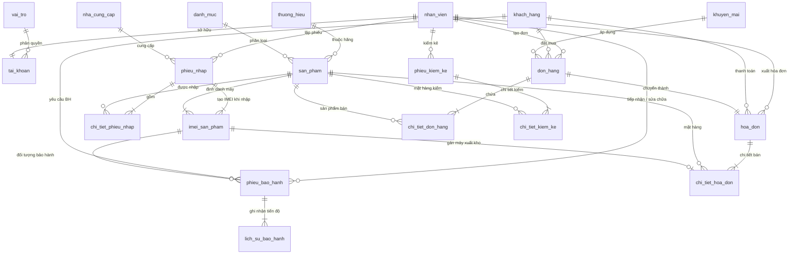

# TÀI LIỆU THIẾT KẾ CƠ SỞ DỮ LIỆU
## ĐỒ ÁN: HỆ THỐNG QUẢN LÝ CỬA HÀNG ĐIỆN THOẠI
**Môn học:** Phân tích Thiết kế Hướng đối tượng (PTTKHĐT)  
**Đơn vị:** Đại học Sài Gòn (SGU)  
**Nhóm thực hiện:** Nhóm 05  
**Giảng viên hướng dẫn:** Thầy Hoàng Mạnh Hà  
**Hệ quản trị CSDL:** MySQL / MariaDB (XAMPP - phpMyAdmin)

---

## 1. TỔNG QUAN VÀ ÁNH XẠ VỚI ĐẶC TẢ USE CASE

Hệ thống quản lý cửa hàng điện thoại gồm 9 phân hệ chức năng tương ứng trực tiếp với các Use Case đã đặc tả trong báo cáo:

| Phân hệ | Use Case liên quan | Bảng CSDL tương ứng | Vai trò trong hệ thống |
| :--- | :--- | :--- | :--- |
| **1. Nhân sự & Tài khoản** | UC2.1, UC2.3.1 - UC2.3.5 | `vai_tro`, `nhan_vien`, `tai_khoan` | Quản lý nhân viên, phân quyền 4 vai trò (Admin/Quản lý, Bán hàng, Kho, Kỹ thuật) |
| **2. Sản phẩm & Danh mục** | UC2.4.1 - UC2.4.5 | `thuong_hieu`, `danh_muc`, `san_pham` | Lưu trữ cấu hình kỹ thuật (RAM, ROM, Chip, Màn hình, Camera), giá bán, bảo hành |
| **3. Nhà cung cấp & Nhập hàng** | UC2.5.1, UC2.5.2 | `nha_cung_cap`, `phieu_nhap`, `chi_tiet_phieu_nhap` | Quản lý NCC, công nợ nhập hàng, phiếu nhập kho |
| **4. Quản lý IMEI (Đặc thù)** | UC2.5.2.1.1, UC2.13.1.1 | `imei_san_pham` | **Trọng tâm ngành điện thoại**: Mỗi máy có mã IMEI riêng, theo dõi từ nhập đến bán và bảo hành |
| **5. Quản lý tồn kho & Kiểm kê** | UC2.6.1, UC2.6.2 | `phieu_kiem_ke`, `chi_tiet_kiem_ke` | Kiểm kê thực tế vs hệ thống, cảnh báo tồn kho dưới định mức |
| **6. Khách hàng** | UC2.12.1 - UC2.12.5 | `khach_hang` | Quản lý thông tin, điểm tích lũy, tra cứu lịch sử mua hàng |
| **7. Khuyến mãi & Voucher** | UC2.14.1, UC2.14.2 | `khuyen_mai` | Giảm % hoặc tiền mặt, kiểm tra điều kiện đơn hàng, thời hạn |
| **8. Bán hàng & Hóa đơn** | UC2.7, UC2.8, UC2.9, UC2.10, UC2.11 | `gio_hang`, `chi_tiet_gio_hang`, `don_hang`, `chi_tiet_don_hang`, `hoa_don`, `chi_tiet_hoa_don` | Quy trình: Giỏ hàng -> Đơn hàng -> Tính tiền -> Thanh toán (Tiền mặt / QR) -> Hóa đơn (gắn IMEI) |
| **9. Quản lý Bảo hành** | UC2.13.1 - UC2.13.4 | `phieu_bao_hanh`, `lich_su_bao_hanh` | Tiếp nhận theo IMEI, phân công KTV, cập nhật vòng đời bảo hành, đóng phiếu |
| **10. Báo cáo thống kê** | UC2.16.1 - UC2.16.4 | `nhat_ky_bao_cao` + 4 Views | Thống kê doanh thu, best-seller, hàng tồn, xuất file PDF/Excel |

---

## 2. SƠ ĐỒ QUAN HỆ THỰC THỂ (ERD LOGICAL MODEL)

---

## 3. CHI TIẾT CÁC BẢNG DỮ LIỆU CHÍNH (DATA DICTIONARY)

### 3.1. Bảng `san_pham`
- **Mục đích:** Lưu thông tin các dòng máy điện thoại.
- **Trường chính:**
  - `ma_san_pham` (PK, VARCHAR(20)): Mã sản phẩm (VD: `SP_IP15PM_256TN`).
  - `ten_san_pham`: Tên đầy đủ có màu và dung lượng.
  - `ma_thuong_hieu`, `ma_danh_muc`: Khóa ngoại.
  - `dong_may`, `mau_sac`, `ram`, `rom`, `chip_xu_ly`, `pin`, `camera`, `man_hinh`: Cấu hình máy.
  - `gia_nhap_tham_khao`, `gia_ban`: Giá tiền.
  - `so_luong_ton`: Tồn kho hiện thời.
  - `dinh_muc_ton_toi_thieu`: Ngưỡng an toàn để phát cảnh báo hết hàng.

### 3.2. Bảng `imei_san_pham` (Điểm nhấn kiến trúc môn PTTKHĐT)
- **Mục đích:** Quản lý từng chiếc máy vật lý trong kho thông qua số IMEI 15 chữ số.
- **Trường chính:**
  - `ma_imei` (PK, VARCHAR(30)): Số IMEI duy nhất.
  - `ma_san_pham` (FK): Thuộc mã sản phẩm nào.
  - `ma_phieu_nhap` (FK): Được nhập từ phiếu nhập nào.
  - `ma_hoa_don` (FK, Nullable): Được xuất bán theo hóa đơn nào.
  - `trang_thai`: `Trong_kho`, `Da_ban`, `Dang_bao_hanh`, `Loi_doi_tra`, `Da_tra_NCC`.
  - `han_bao_hanh`: Ngày hết hạn bảo hành của máy (tính tự động khi bán).

### 3.3. Bảng `don_hang` và `hoa_don`
- **Mục đích:** Tách biệt rõ 2 giai đoạn theo đặc tả Use Case: "Tạo & Xác nhận đơn hàng" (UC2.8) và "Thanh toán & Lập hóa đơn" (UC2.10, UC2.11).
- `hoa_don` lưu trữ: Phương thức thanh toán (`Tien_mat`, `Chuyen_khoan_QR`), tiền khách đưa, tiền thừa, thuế VAT, tiền giảm giá từ khuyến mãi.
- `chi_tiet_hoa_don` liên kết trực tiếp `ma_imei` để đảm bảo lưu vết chính xác khách hàng mua chiếc máy nào.

### 3.4. Bảng `phieu_bao_hanh` & `lich_su_bao_hanh`
- **Mục đích:** Quản lý quy trình bảo hành (UC2.13).
- Lưu vết từ lúc nhân viên tiếp nhận -> kỹ thuật viên chẩn đoán, sửa chữa -> bàn giao cho khách.
- Bảng con `lich_su_bao_hanh` ghi nhận từng bước chuyển trạng thái theo thời gian.

---

## 4. TÍNH NĂNG TỰ ĐỘNG HÓA VÀ CÁC VIEWS THỐNG KÊ

### 4.1. Triggers tự động:
1. `trg_sau_khi_them_imei`: Khi nhân viên kho quét thêm mã IMEI vào phiếu nhập, hệ thống tự động cộng dồn số lượng tồn `so_luong_ton` trong bảng `san_pham`.
2. `trg_sau_khi_ban_imei`: Khi lập hóa đơn bán hàng gắn mã IMEI, hệ thống tự động:
   - Đổi trạng thái IMEI sang `Da_ban`.
   - Tính ngày hết hạn bảo hành = Ngày lập hóa đơn + số tháng bảo hành của sản phẩm.
   - Tự động trừ tồn kho của sản phẩm.
3. `trg_khi_tiep_nhan_bao_hanh`: Chuyển trạng thái IMEI sang `Dang_bao_hanh` và tự động ghi dòng lịch sử tiến độ đầu tiên.
4. `trg_khi_hoan_tat_bao_hanh`: Khi kỹ thuật viên bàn giao hoàn tất, trạng thái máy chuyển lại `Da_ban` và đóng phiếu.

### 4.2. Views phục vụ thống kê (Không cần viết câu truy vấn phức tạp):
- `v_canh_bao_ton_kho`: Trả về danh sách máy có số lượng tồn <= định mức tối thiểu.
- `v_top_san_pham_ban_chay`: Bảng xếp hạng sản phẩm bán chạy nhất kèm doanh thu.
- `v_thong_ke_doanh_thu`: Báo cáo doanh thu theo từng ngày, tháng, năm.
- `v_tra_cuu_bao_hanh`: Tra cứu nhanh theo IMEI hoặc SĐT khách hàng xem máy còn hạn bảo hành hay không.

---

## 5. HƯỚNG DẪN IMPORT VÀO XAMPP (PHPMYADMIN)

1. Mở phần mềm **XAMPP Control Panel** và nhấn **Start** tại 2 module: **Apache** và **MySQL**.
2. Mở trình duyệt web và truy cập: `http://localhost/phpmyadmin/`.
3. Nhấp vào tab **Nhập (Import)** ở thanh menu trên cùng.
4. Chọn tệp: Duyệt đến file `quanly_cuahang_dienthoai.sql` tại thư mục đồ án: `e:\PTTKHĐT\quanly_cuahang_dienthoai.sql`.
5. Bấm nút **Thực hiện (Import / Go)** ở dưới cùng.
6. Cơ sở dữ liệu `quanly_cuahang_dienthoai` sẽ được tạo đầy đủ với 22 bảng, 4 Views, 4 Triggers và dữ liệu mẫu thực tế.
