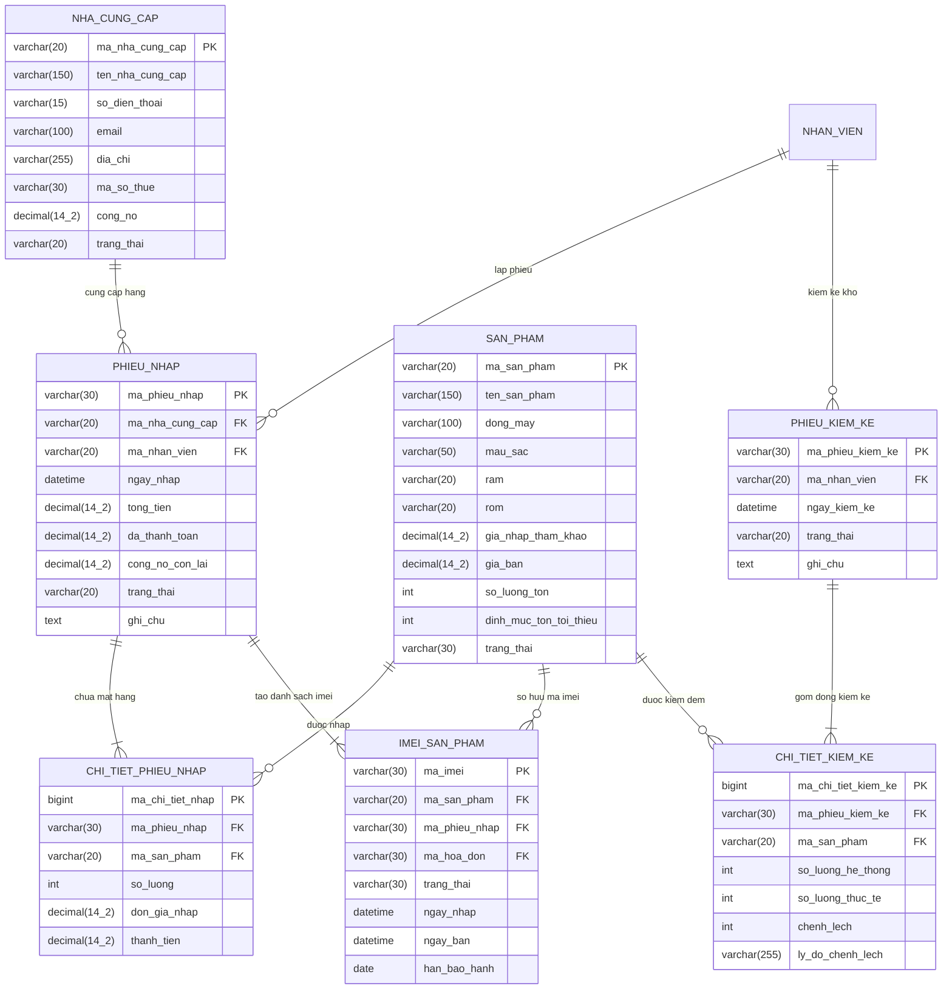

# THIẾT KẾ CLASS DIAGRAM & MÔ HÌNH DỮ LIỆU QUAN HỆ (RDM)
## PHÂN HỆ: QUẢN LÝ NHẬP HÀNG & QUẢN LÝ KHO HÀNG
**Môn học:** Phân tích Thiết kế Hướng đối tượng (PTTKHĐT)  
**Nhóm thực hiện:** Nhóm 05 - Đặng Hoàng Nam (MSSV: 3124560058)  
**Tài liệu tham chiếu:** Báo cáo đề tài `S7_Nhom05_Lan4.docx`

---

## 1. CLASS DIAGRAM (SƠ ĐỒ LỚP THỰC THỂ / DATA CLASSES)

> [!NOTE]
> Tuân theo yêu cầu: Chỉ xây dựng các lớp dữ liệu (**Entity Classes / Data Classes**) tương ứng với các thực thể được lưu trữ trong cơ sở dữ liệu (Database), không chứa các lớp điều khiển nghiệp vụ (Controller) hoặc lớp giao diện (Boundary/GUI).

### 1.1. Sơ đồ Mermaid Class Diagram

```mermaid
classDiagram
    class NhaCungCap {
        - String maNhaCungCap
        - String tenNhaCungCap
        - String soDienThoai
        - String email
        - String diaChi
        - String maSoThue
        - Double congNo
        - String trangThai
        + getMaNhaCungCap() String
        + setMaNhaCungCap(String) void
        + getTenNhaCungCap() String
        + setTenNhaCungCap(String) void
        + getSoDienThoai() String
        + setSoDienThoai(String) void
        + getEmail() String
        + setEmail(String) void
        + getDiaChi() String
        + setDiaChi(String) void
        + getMaSoThue() String
        + setMaSoThue(String) void
        + getCongNo() Double
        + setCongNo(Double) void
        + getTrangThai() String
        + setTrangThai(String) void
    }

    class SanPham {
        - String maSanPham
        - String tenSanPham
        - String dongMay
        - String mauSac
        - String ram
        - String rom
        - Double giaNhapThamKhao
        - Double giaBan
        - Integer soLuongTon
        - Integer dinhMucTonToiThieu
        - String trangThai
        + getMaSanPham() String
        + setMaSanPham(String) void
        + getTenSanPham() String
        + setTenSanPham(String) void
        + getDongMay() String
        + setDongMay(String) void
        + getMauSac() String
        + setMauSac(String) void
        + getRam() String
        + setRam(String) void
        + getRom() String
        + setRom(String) void
        + getGiaNhapThamKhao() Double
        + setGiaNhapThamKhao(Double) void
        + getGiaBan() Double
        + setGiaBan(Double) void
        + getSoLuongTon() Integer
        + setSoLuongTon(Integer) void
        + getDinhMucTonToiThieu() Integer
        + setDinhMucTonToiThieu(Integer) void
        + getTrangThai() String
        + setTrangThai(String) void
    }

    class PhieuNhap {
        - String maPhieuNhap
        - String maNhaCungCap
        - String maNhanVien
        - LocalDateTime ngayNhap
        - Double tongTien
        - Double daThanhToan
        - Double congNoConLai
        - String trangThai
        - String ghiChu
        + getMaPhieuNhap() String
        + setMaPhieuNhap(String) void
        + getMaNhaCungCap() String
        + setMaNhaCungCap(String) void
        + getMaNhanVien() String
        + setMaNhanVien(String) void
        + getNgayNhap() LocalDateTime
        + setNgayNhap(LocalDateTime) void
        + getTongTien() Double
        + setTongTien(Double) void
        + getDaThanhToan() Double
        + setDaThanhToan(Double) void
        + getCongNoConLai() Double
        + setCongNoConLai(Double) void
        + getTrangThai() String
        + setTrangThai(String) void
        + getGhiChu() String
        + setGhiChu(String) void
    }

    class ChiTietPhieuNhap {
        - Long maChiTietNhap
        - String maPhieuNhap
        - String maSanPham
        - Integer soLuong
        - Double donGiaNhap
        - Double thanhTien
        + getMaChiTietNhap() Long
        + setMaChiTietNhap(Long) void
        + getMaPhieuNhap() String
        + setMaPhieuNhap(String) void
        + getMaSanPham() String
        + setMaSanPham(String) void
        + getSoLuong() Integer
        + setSoLuong(Integer) void
        + getDonGiaNhap() Double
        + setDonGiaNhap(Double) void
        + getThanhTien() Double
        + setThanhTien(Double) void
    }

    class ImeiSanPham {
        - String maImei
        - String maSanPham
        - String maPhieuNhap
        - String maHoaDon
        - String trangThai
        - LocalDateTime ngayNhap
        - LocalDateTime ngayBan
        - LocalDate hanBaoHanh
        + getMaImei() String
        + setMaImei(String) void
        + getMaSanPham() String
        + setMaSanPham(String) void
        + getMaPhieuNhap() String
        + setMaPhieuNhap(String) void
        + getMaHoaDon() String
        + setMaHoaDon(String) void
        + getTrangThai() String
        + setTrangThai(String) void
        + getNgayNhap() LocalDateTime
        + setNgayNhap(LocalDateTime) void
        + getNgayBan() LocalDateTime
        + setNgayBan(LocalDateTime) void
        + getHanBaoHanh() LocalDate
        + setHanBaoHanh(LocalDate) void
    }

    class PhieuKiemKe {
        - String maPhieuKiemKe
        - String maNhanVien
        - LocalDateTime ngayKiemKe
        - String trangThai
        - String ghiChu
        + getMaPhieuKiemKe() String
        + setMaPhieuKiemKe(String) void
        + getMaNhanVien() String
        + setMaNhanVien(String) void
        + getNgayKiemKe() LocalDateTime
        + setNgayKiemKe(LocalDateTime) void
        + getTrangThai() String
        + setTrangThai(String) void
        + getGhiChu() String
        + setGhiChu(String) void
    }

    class ChiTietKiemKe {
        - Long maChiTietKiemKe
        - String maPhieuKiemKe
        - String maSanPham
        - Integer soLuongHeThong
        - Integer soLuongThucTe
        - Integer chenhLech
        - String lyDoChenhLech
        + getMaChiTietKiemKe() Long
        + setMaChiTietKiemKe(Long) void
        + getMaPhieuKiemKe() String
        + setMaPhieuKiemKe(String) void
        + getMaSanPham() String
        + setMaSanPham(String) void
        + getSoLuongHeThong() Integer
        + setSoLuongHeThong(Integer) void
        + getSoLuongThucTe() Integer
        + setSoLuongThucTe(Integer) void
        + getChenhLech() Integer
        + setChenhLech(Integer) void
        + getLyDoChenhLech() String
        + setLyDoChenhLech(String) void
    }

    class NhanVien {
        - String maNhanVien
        - String hoTen
        - String soDienThoai
        - String email
        - String chucVu
        + getMaNhanVien() String
        + getHoTen() String
        + getChucVu() String
    }

    %% Quan hệ giữa các thực thể
    NhaCungCap "1" --> "0..*" PhieuNhap : cung_cap_boi
    NhanVien "1" --> "0..*" PhieuNhap : lap_phieu
    PhieuNhap "1" *-- "1..*" ChiTietPhieuNhap : chi_tiet
    SanPham "1" --> "0..*" ChiTietPhieuNhap : mat_hang_nhap
    PhieuNhap "1" *-- "1..*" ImeiSanPham : sinh_ra_imei
    SanPham "1" --> "0..*" ImeiSanPham : dinh_danh_may

    NhanVien "1" --> "0..*" PhieuKiemKe : thuc_hien_kiem_ke
    PhieuKiemKe "1" *-- "1..*" ChiTietKiemKe : gom_chi_tiet
    SanPham "1" --> "0..*" ChiTietKiemKe : kiem_ke_mat_hang
```

---

## 2. MÔ HÌNH DỮ LIỆU QUAN HỆ (RDM - RELATIONAL DATA MODEL)

### 2.1. Lược đồ quan hệ chuẩn (3NF)

- **NHA_CUNG_CAP** (<ins>ma_nha_cung_cap</ins>, ten_nha_cung_cap, so_dien_thoai, email, dia_chi, ma_so_thue, cong_no, trang_thai)
- **SAN_PHAM** (<ins>ma_san_pham</ins>, ten_san_pham, dong_may, mau_sac, ram, rom, gia_nhap_tham_khao, gia_ban, so_luong_ton, dinh_muc_ton_toi_thieu, trang_thai)
- **PHIEU_NHAP** (<ins>ma_phieu_nhap</ins>, *ma_nha_cung_cap*, *ma_nhan_vien*, ngay_nhap, tong_tien, da_thanh_toan, cong_no_con_lai, trang_thai, ghi_chu)
- **CHI_TIET_PHIEU_NHAP** (<ins>ma_chi_tiet_nhap</ins>, *ma_phieu_nhap*, *ma_san_pham*, so_luong, don_gia_nhap, thanh_tien)
- **IMEI_SAN_PHAM** (<ins>ma_imei</ins>, *ma_san_pham*, *ma_phieu_nhap*, *ma_hoa_don*, trang_thai, ngay_nhap, ngay_ban, han_bao_hanh)
- **PHIEU_KIEM_KE** (<ins>ma_phieu_kiem_ke</ins>, *ma_nhan_vien*, ngay_kiem_ke, trang_thai, ghi_chu)
- **CHI_TIET_KIEM_KE** (<ins>ma_chi_tiet_kiem_ke</ins>, *ma_phieu_kiem_ke*, *ma_san_pham*, so_luong_he_thong, so_luong_thuc_te, chenh_lech, ly_do_chenh_lech)

*(Ghi chú: Thuộc tính gạch chân là Khóa chính (PK), thuộc tính in nghiêng có dấu `*` là Khóa ngoại (FK))*.

---

### 2.2. Sơ đồ Quan hệ Thực thể RDM (Entity-Relationship Diagram)

---

### 2.3. Bảng Từ điển Dữ liệu (Data Dictionary)

#### Bảng 1: `nha_cung_cap` (Nhà cung cấp)
| Tên cột | Kiểu dữ liệu | Ràng buộc | Diễn giải |
| :--- | :--- | :--- | :--- |
| `ma_nha_cung_cap` | VARCHAR(20) | PRIMARY KEY | Mã NCC duy nhất (VD: NCC01, NCC02) |
| `ten_nha_cung_cap` | VARCHAR(150) | NOT NULL | Tên công ty / nhà phân phối |
| `so_dien_thoai` | VARCHAR(15) | NOT NULL | Số điện thoại liên hệ |
| `email` | VARCHAR(100) | NULL | Địa chỉ thư điện tử |
| `dia_chi` | VARCHAR(255) | NOT NULL | Địa chỉ trụ sở/kho giao hàng |
| `ma_so_thue` | VARCHAR(30) | NULL | Mã số thuế doanh nghiệp |
| `cong_no` | DECIMAL(14,2)| DEFAULT 0.00 | Số tiền cửa hàng còn nợ NCC |
| `trang_thai` | VARCHAR(20) | NOT NULL DEFAULT 'Dang_hop_tac' | Trạng thái hợp tác ('Dang_hop_tac', 'Ngung_hop_tac') |

#### Bảng 2: `phieu_nhap` (Phiếu nhập hàng)
| Tên cột | Kiểu dữ liệu | Ràng buộc | Diễn giải |
| :--- | :--- | :--- | :--- |
| `ma_phieu_nhap` | VARCHAR(30) | PRIMARY KEY | Mã phiếu nhập duy nhất (VD: PN20261113_01) |
| `ma_nha_cung_cap` | VARCHAR(20) | NOT NULL, FK | Khóa ngoại tham chiếu `nha_cung_cap` |
| `ma_nhan_vien` | VARCHAR(20) | NOT NULL, FK | Khóa ngoại nhân viên kho lập phiếu |
| `ngay_nhap` | DATETIME | NOT NULL DEFAULT CURRENT_TIMESTAMP | Thời gian lập phiếu nhập |
| `tong_tien` | DECIMAL(14,2)| NOT NULL DEFAULT 0.00 | Tổng giá trị hàng nhập |
| `da_thanh_toan` | DECIMAL(14,2)| NOT NULL DEFAULT 0.00 | Số tiền đã thanh toán cho NCC |
| `cong_no_con_lai` | DECIMAL(14,2)| DEFAULT 0.00 | Công nợ còn lại (tong_tien - da_thanh_toan) |
| `trang_thai` | VARCHAR(20) | NOT NULL DEFAULT 'Hoan_thanh' | Trạng thái ('Cho_duyet', 'Hoan_thanh', 'Da_huy') |
| `ghi_chu` | TEXT | NULL | Ghi chú thêm |

#### Bảng 3: `chi_tiet_phieu_nhap` (Chi tiết phiếu nhập hàng)
| Tên cột | Kiểu dữ liệu | Ràng buộc | Diễn giải |
| :--- | :--- | :--- | :--- |
| `ma_chi_tiet_nhap` | BIGINT | PRIMARY KEY AUTO_INCREMENT | Mã tự tăng định danh dòng chi tiết |
| `ma_phieu_nhap` | VARCHAR(30) | NOT NULL, FK | Tham chiếu `phieu_nhap` |
| `ma_san_pham` | VARCHAR(20) | NOT NULL, FK | Tham chiếu `san_pham` |
| `so_luong` | INT | NOT NULL CHECK (so_luong > 0) | Số lượng nhập |
| `don_gia_nhap` | DECIMAL(14,2)| NOT NULL CHECK (don_gia_nhap >= 0) | Đơn giá nhập của mỗi sản phẩm |
| `thanh_tien` | DECIMAL(14,2)| NOT NULL | Thành tiền (so_luong * don_gia_nhap) |

#### Bảng 4: `imei_san_pham` (Danh sách mã IMEI của máy)
| Tên cột | Kiểu dữ liệu | Ràng buộc | Diễn giải |
| :--- | :--- | :--- | :--- |
| `ma_imei` | VARCHAR(30) | PRIMARY KEY | Mã IMEI 15 chữ số duy nhất cho từng máy vật lý |
| `ma_san_pham` | VARCHAR(20) | NOT NULL, FK | Tham chiếu dòng sản phẩm `san_pham` |
| `ma_phieu_nhap` | VARCHAR(30) | NOT NULL, FK | Phiếu nhập sinh ra máy này |
| `ma_hoa_don` | VARCHAR(30) | NULL | Hóa đơn xuất bán (nếu đã bán) |
| `trang_thai` | VARCHAR(30) | NOT NULL DEFAULT 'Trong_kho' | 'Trong_kho', 'Da_ban', 'Dang_bao_hanh', 'Loi_doi_tra', 'Da_tra_NCC' |
| `ngay_nhap` | DATETIME | DEFAULT CURRENT_TIMESTAMP | Ngày nhập kho |
| `ngay_ban` | DATETIME | NULL | Ngày máy được xuất bán |
| `han_bao_hanh` | DATE | NULL | Ngày hết hạn bảo hành |

#### Bảng 5: `san_pham` (Thông tin mặt hàng & số lượng tồn kho)
| Tên cột | Kiểu dữ liệu | Ràng buộc | Diễn giải |
| :--- | :--- | :--- | :--- |
| `ma_san_pham` | VARCHAR(20) | PRIMARY KEY | Mã sản phẩm (VD: SP_IP15PM_256) |
| `ten_san_pham` | VARCHAR(150) | NOT NULL | Tên sản phẩm hiển thị |
| `dong_may` | VARCHAR(100) | NOT NULL | Dòng máy (iPhone 15 Series, Galaxy S24...) |
| `mau_sac` | VARCHAR(50) | NOT NULL | Màu sắc máy |
| `ram` | VARCHAR(20) | NOT NULL | Dung lượng RAM |
| `rom` | VARCHAR(20) | NOT NULL | Bộ nhớ trong |
| `gia_nhap_tham_khao` | DECIMAL(14,2)| NOT NULL DEFAULT 0.00 | Giá nhập ước tính |
| `gia_ban` | DECIMAL(14,2)| NOT NULL DEFAULT 0.00 | Giá bán niêm yết |
| `so_luong_ton` | INT | NOT NULL DEFAULT 0 | Số lượng máy vật lý sẵn có trong kho |
| `dinh_muc_ton_toi_thieu`| INT | NOT NULL DEFAULT 2 | Định mức tồn tối thiểu để kích hoạt cảnh báo hết hàng |
| `trang_thai` | VARCHAR(30) | NOT NULL DEFAULT 'Dang_kinh_doanh'| Trạng thái kinh doanh |

#### Bảng 6: `phieu_kiem_ke` (Phiếu kiểm kê kho)
| Tên cột | Kiểu dữ liệu | Ràng buộc | Diễn giải |
| :--- | :--- | :--- | :--- |
| `ma_phieu_kiem_ke` | VARCHAR(30) | PRIMARY KEY | Mã phiếu kiểm kê (VD: PKK20261113_01) |
| `ma_nhan_vien` | VARCHAR(20) | NOT NULL, FK | Nhân viên kho thực hiện kiểm kê |
| `ngay_kiem_ke` | DATETIME | NOT NULL DEFAULT CURRENT_TIMESTAMP | Thời gian kiểm kê |
| `trang_thai` | VARCHAR(20) | NOT NULL DEFAULT 'Da_can_bang' | 'Da_can_bang', 'Cho_xu_ly' |
| `ghi_chu` | TEXT | NULL | Ghi chú đợt kiểm kê |

#### Bảng 7: `chi_tiet_kiem_ke` (Chi tiết kết quả đếm kiểm kê)
| Tên cột | Kiểu dữ liệu | Ràng buộc | Diễn giải |
| :--- | :--- | :--- | :--- |
| `ma_chi_tiet_kiem_ke`| BIGINT | PRIMARY KEY AUTO_INCREMENT | Mã tự tăng định danh chi tiết |
| `ma_phieu_kiem_ke` | VARCHAR(30) | NOT NULL, FK | Tham chiếu `phieu_kiem_ke` |
| `ma_san_pham` | VARCHAR(20) | NOT NULL, FK | Tham chiếu `san_pham` |
| `so_luong_he_thong` | INT | NOT NULL | Số lượng tồn kho trên phần mềm lúc kiểm |
| `so_luong_thuc_te` | INT | NOT NULL | Số lượng hàng hóa đếm thực tế trong kho |
| `chenh_lech` | INT | NOT NULL | Độ chênh lệch (thực tế - hệ thống) |
| `ly_do_chenh_lech` | VARCHAR(255) | NULL | Ghi chú lý do nếu lệch số lượng |
